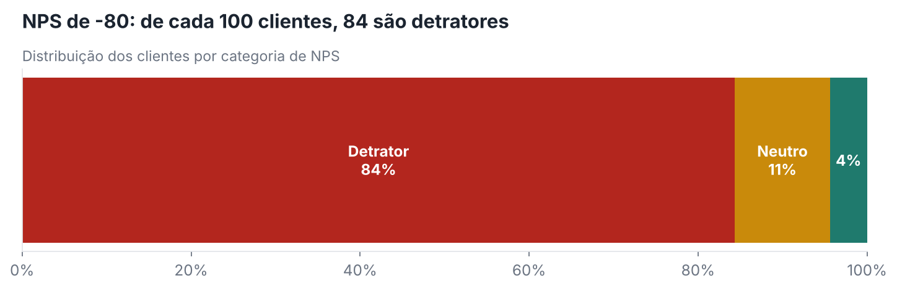
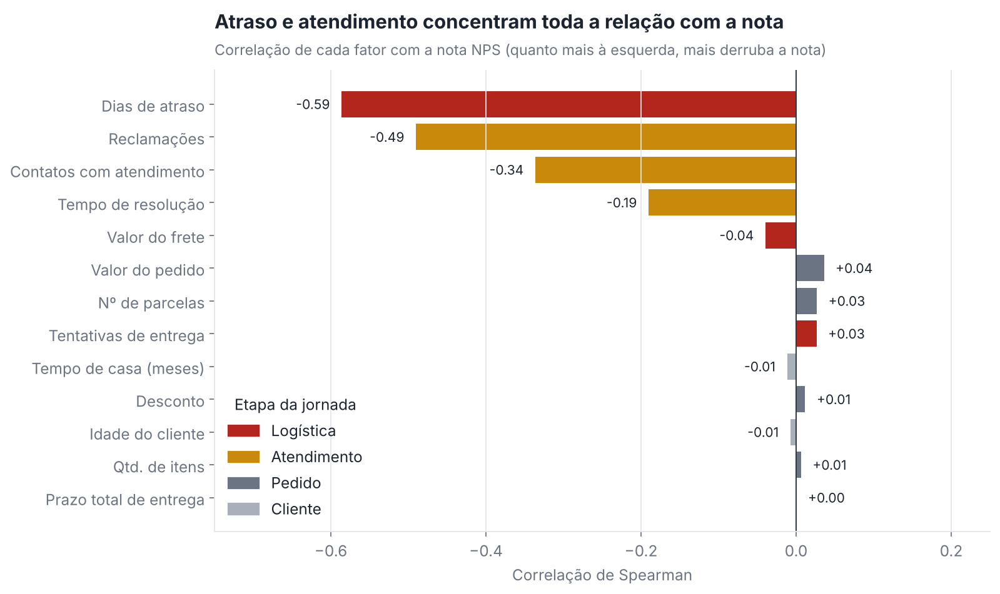
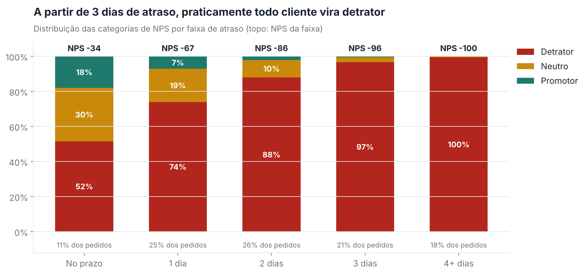
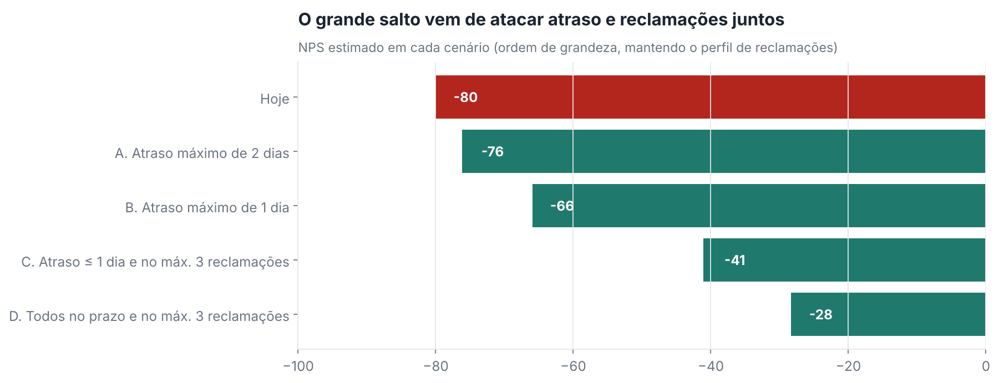

# Relatório executivo · O que explica a satisfação dos nossos clientes

**Para:** Diretoria de Operações, Logística, Atendimento e Experiência do Cliente
**Base analisada:** 2.500 pedidos com resposta de NPS
**Leitura estimada:** 6 minutos

---

## A mensagem em três frases

1. Nosso NPS é **−80**: de cada 100 clientes, **84 são detratores** e só **4 são promotores**.
2. O que define a nota **não é quem o cliente é**, e sim **o que acontece com o pedido dele**: atraso na entrega e atrito no atendimento explicam a maior parte da variação.
3. O cliente **aceita esperar, mas não aceita ser surpreendido**: o prazo total não muda a nota; cada dia além do prometido, sim.

---

## 1. Onde estamos

| Indicador | Valor |
|---|---|
| NPS | **−80** (margem de erro: −82 a −78) |
| Detratores / Neutros / Promotores | 84% / 11% / 4% |
| Nota média | 4,4 de 10 |
| Pedidos entregues com atraso | **89%** (atraso médio de 2,2 dias) |
| Pedidos sem atraso **e** com no máximo 1 reclamação | **3%** |

**Por que isso importa:** na base, nenhum detrator voltou a comprar em 30 dias, contra 38% dos neutros e 100% dos promotores. Os números exatos são “perfeitos demais” (ver limitações), mas a direção é inequívoca: **insatisfação custa recompra**.

---

## 2. O que mais pesa na nota

| Fator | Efeito na nota (0 a 10) | Leitura |
|---|---|---|
| **Atraso na entrega** | **−1,0 ponto por dia** | Fator nº 1, responde por ~3/4 do que conseguimos explicar |
| **Reclamações** | −0,4 por reclamação | A 2ª reclamação é o ponto de virada |
| **Contatos com o atendimento** | −0,3 por contato | Cada contato é um sinal de que algo deu errado |
| **Tempo de resolução** | −0,15 por dia | Efeito gradual |
| Prazo total, frete, valor, desconto, parcelas, itens, tentativas de entrega | ≈ 0 | **Não diferenciam a nota** |
| Região, idade, tempo de casa | ≈ 0 | **Não diferenciam a nota** |

Juntos, os fatores operacionais explicam **56%** da variação da nota. O restante depende de aspectos que a base não mede (produto, preço versus concorrência, comunicação).

---

## 3. O ponto de ruptura

| Atraso | NPS | O que acontece |
|---|---|---|
| No prazo | −34 | Ainda negativo: pontualidade é necessária, mas não suficiente |
| **1 dia** | **−67** | Metade de toda a queda acontece **no primeiro dia** |
| 2 dias | −86 | 88% de detratores |
| **3 dias** | **−96** | **Ruptura: 97% de detratores** |
| 4+ dias | −100 | Nenhum promotor |

No atendimento, as viradas são a **2ª reclamação** (a maioria passa a ser detratora) e o **3º contato** (95% de detratores).

---

## 4. O que gera detratores

**9 em cada 10 detratores** passaram por pelo menos uma de duas situações que a operação **já mede antes da pesquisa**:

- **Atraso de 2 dias ou mais** (72% dos detratores);
- **4 reclamações ou mais** (70% dos detratores).

Quando os dois se somam, o efeito é ainda pior: sem atraso e com até 1 reclamação, a nota média é **8,1**; com 4+ dias de atraso e 6+ reclamações, **1,3**.

---

## 5. Que cliente dá nota alta ou baixa?

**O perfil não importa; a jornada, sim.** Região, idade, tempo de casa e valor do pedido têm NPS praticamente igual (todos entre −86 e −75, sem diferença estatística).

| | Promotor típico | Detrator típico |
|---|---|---|
| Dias de atraso | 0,7 | 2,4 (3×) |
| Reclamações | 2,3 | 4,4 (2×) |
| Contatos com o atendimento | 0,7 | 1,6 (2×) |
| Prazo total, valor do pedido, idade, tempo de casa | iguais | iguais |

Implicação: **segmentar ações por perfil de cliente não resolve o problema. As ações devem ser segmentadas pela situação do pedido.**

---

## 6. Recomendações

Ordenadas por impacto esperado e facilidade de implementação.

| # | Ação | Área dona | Por que | Indicador de sucesso |
|---|---|---|---|---|
| 1 | **Prometer o que dá para cumprir.** Recalibrar o prazo exibido no checkout por rota e transportadora, com margem de segurança | Logística + Produto | Prazo maior não reduz a nota; atraso reduz. Trocar “rápido e atrasado” por “realista e pontual” | % de pedidos no prazo (meta inicial: sair de 11% para > 50%) |
| 2 | **Avisar antes de o cliente perguntar.** Alerta automático no 1º dia de atraso, com nova data e canal direto | Atendimento + CRM | O 1º dia concentra metade da queda; comunicação proativa evita contato e reclamação | % de atrasos comunicados proativamente; contatos por pedido |
| 3 | **Torre de controle de pedidos em risco.** Fila prioritária com gatilhos objetivos: atraso ≥ 1 dia, 2ª reclamação, 2º contato | Operações | Os gatilhos cobrem 90% dos detratores e são conhecidos antes da pesquisa | % de pedidos em risco tratados em até 24h |
| 4 | **Resolver na primeira vez.** Meta de resolução no 1º contato e autonomia de compensação para a linha de frente | Atendimento | Cada contato e cada reclamação extra custam nota | Taxa de resolução no 1º contato; reclamações por pedido |
| 5 | **Gestão por transportadora.** SLA e penalidades atrelados à pontualidade, não só ao custo | Logística + Compras | Frete não move a nota; pontualidade move | Pontualidade por transportadora e rota |
| 6 | **Não usar desconto como remédio.** Cupom e parcelamento não compram satisfação nesta base | Comercial | Evita gasto sem retorno em satisfação | Margem preservada |
| 7 | **Medir durante a jornada.** Painel semanal com os gatilhos acima como indicadores antecedentes do NPS | CX + Dados | Sai da gestão reativa para a preventiva | Correlação painel × NPS ao longo do tempo |

### Ordem de grandeza do ganho

Simulando cenários a partir do comportamento de pedidos semelhantes (estimativa de **direção e ordem de grandeza**, não promessa):

| Cenário | NPS estimado | Ganho |
|---|---|---|
| Hoje | −80 | — |
| Atraso máximo de 2 dias | −76 | +4 |
| Atraso máximo de 1 dia | −66 | +14 |
| Atraso ≤ 1 dia **e** no máximo 3 reclamações | −41 | +39 |
| Todos no prazo **e** no máximo 3 reclamações | −28 | +52 |

Duas lições: **cortar só os atrasos extremos ajuda pouco** (2 dias já é zona de detração), e **logística e atendimento se reforçam**, por isso precisam avançar juntos. Mesmo no melhor cenário o NPS segue negativo: há fatores fora desta base (produto, preço, comunicação) a investigar.

---

## 7. Limitações e cuidados

| Limitação | Impacto na decisão |
|---|---|
| **Associação não é causa.** Os achados mostram o que anda junto com a nota, não provam o efeito de uma ação | Validar as recomendações com **pilotos controlados** (ex.: prazo recalibrado em uma região, comparada com outra) antes de escalar |
| **Base com sinais de simulação** (recompra 100%/0%, notas decimais) | Usar a **direção** dos achados; recalcular magnitudes com dados reais antes de projetar receita |
| **Inconsistências de cadastro** (ex.: 4,8% com atraso maior que o prazo total) | Testamos: os achados **não mudam** sem esses registros. Ainda assim, alinhar definições com os donos dos dados |
| **Sem data do pedido** | Não é possível analisar sazonalidade nem picos (ex.: Black Friday) |
| **Sem prazo prometido explícito** | Não sabemos se o atraso vem de promessa agressiva ou de falha de execução, informação essencial para a ação nº 1 |
| **44% da variação não é explicada** | Produto, preço, concorrência e comunicação não estão na base e podem ser relevantes |
| **Viés de resposta da pesquisa** | Quem responde tende a estar nos extremos; monitorar taxa de resposta |
| **Risco de gaming** | Se o NPS virar meta individual, pode ser manipulado; usar como indicador de gestão |

---

## 8. Próximos passos

1. **Validar definições** com os donos dos dados (prazo total, reclamações, CSAT, valor líquido).
2. **Obter dados adicionais:** data do pedido, prazo prometido, transportadora, categoria de produto, canal de reclamação.
3. **Rodar 2 pilotos** de 60 dias: prazo recalibrado (ação 1) e aviso proativo de atraso (ação 2), com grupo de controle.
4. **Construir o modelo preditivo** (próxima fase): estimar, para cada pedido em andamento, a probabilidade de o cliente se tornar detrator, usando **apenas** dados disponíveis antes da pesquisa, para alimentar a torre de controle.
